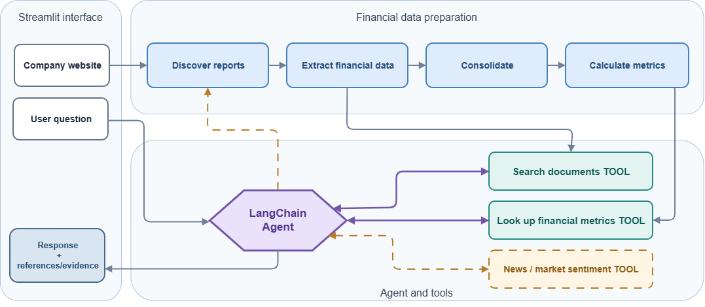

# Business Performance Agent

A work-in-progress AI agent that answers questions about a company's financial performance and helps explain the trends and business drivers behind the numbers.

The goal is to bring financial disclosures, calculations and business context into one question-led analysis workflow. **Honasa Consumer** is the first company used to test the pipeline, but the code is designed to work with other companies too.

## Workflow



## What's built so far

- **Document discovery:** Finds financial reports, investor presentations and earnings-call transcripts from a company's website.
- **Financial extraction:** Reads selected PDFs using an LLM and records financial figures alongside their reporting periods and sources.
- **Data preparation:** Standardises metric names, units and reporting periods, then consolidates the extracted figures. Source conflicts and annual-versus-quarterly discrepancies are retained as flags.
- **Calculation engine:** Computes growth rates, margins, cost ratios, year-on-year changes and trailing-twelve-month metrics using Python, without relying on the LLM for arithmetic.
- **Document search:** Searches downloaded reports and transcripts for relevant business explanations, with source URLs and PDF page references.
- **Financial Q&A:** A LangChain agent uses financial lookup and document-search tools to investigate questions and generate evidence-backed answers.

The **Streamlit interface** brings company website input, financial Q&A and document processing together. Users can see the agent's tool calls and inspect supporting references. Preparation and calculations for new companies still run separately in Python.

## Run locally

1. **Activate the virtual environment.**

   In Windows PowerShell, switch to Command Prompt and activate the existing environment:

   ```bat
   cmd
   .\.venv\Scripts\activate.bat
   ```

2. **Install dependencies:**

   ```bat
   pip install -r requirements.txt
   ```

3. Configure your LLM API key locally using `.streamlit/secrets.toml` or the `GEMINI_API_KEY` environment variable.

4. **Launch Streamlit:**

   ```bat
   streamlit run app.py
   ```

5. For a new company, once financial documents have been extracted, prepare the data and calculate financial metrics:

   ```bat
   python financial_data_preparation.py
   python financial_calculations.py --run-dir data/runs/<run-folder>
   ```

6. Ask questions through Streamlit or run the reasoning agent directly:

   ```bat
   python financial_reasoning_agent.py --run-dir data/runs/<run-folder>
   ```

Downloaded PDFs, cached outputs, run histories and API keys are not included in this repository.

## Coming next

Later, it will be able to request additional documents 

The next steps are to enable question-specific calculations, let the agent request additional documents when needed, and market research when a question needs more evidence. Lastly, bring the full experience into a conversational Streamlit interface.
